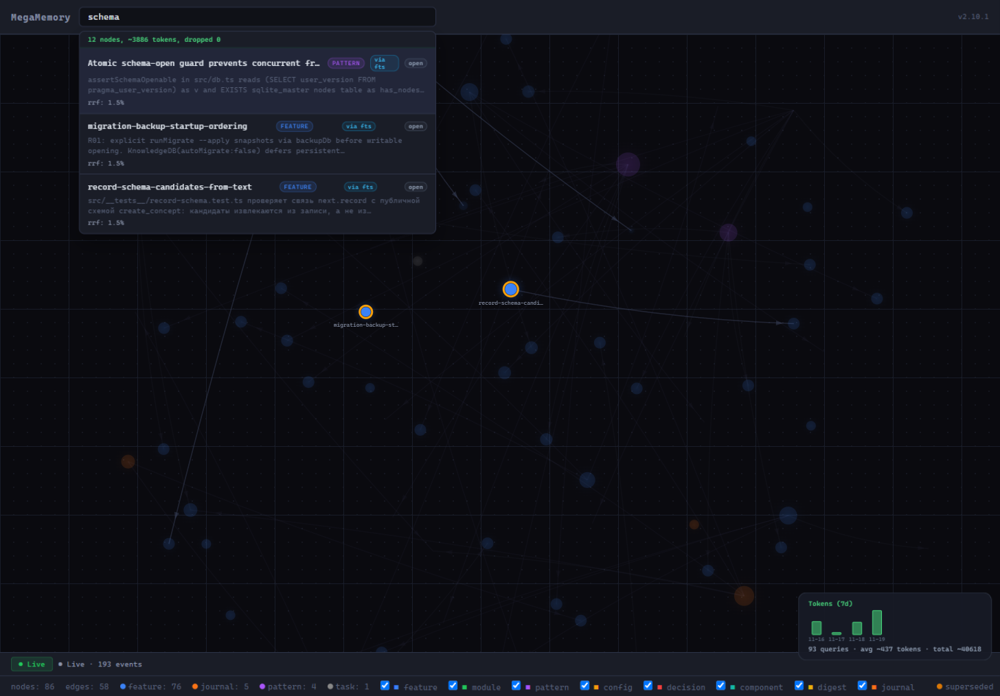

<p align="center">
  <h1 align="center">MegaMemory <sub><sup>форк</sup></sub></h1>
</p>
<p align="center">Граф знаний проекта для кодинг-агентов — мультиязычный, экономный по токенам, видимый в интерфейсе.</p>

<p align="center">
  <a href="./LICENSE"></a>
  
  
</p>

<p align="center">
  
</p>

> **Форк [0xK3vin/MegaMemory](https://github.com/0xK3vin/MegaMemory) v1.6.2 (MIT).**
> Форк npm-пакета [`megamemory`](https://www.npmjs.com/package/megamemory), публикуется как `@bloodyeagle/megamemory`.
> Идея и база — upstream. В форке: исправлены идентификаторы для любых языков, добавлены
> гибридный поиск, бюджет контекста, актуальность фактов, digest-узлы, экспорт и учёт токенов.
> English version: [README.md](./README.md).

[MCP](https://modelcontextprotocol.io/)-сервер, который даёт кодинг-агенту строить граф концепций,
архитектуры и решений — и **помнить проект между сессиями**.

Индексатор — сам LLM. Никакого AST-парсинга и статического анализа: агент читает код, записывает
концепции своими словами и запрашивает их перед следующими задачами. В графе хранятся **концепции** —
фичи, модули, паттерны, решения, — а не символы кода. Всё лежит в SQLite проекта:
`.megamemory/knowledge.db`.

---

## Что изменилось в форке

| Область | Upstream 1.6.2 | Этот форк |
|---|---|---|
| Идентификаторы | slug вырезает всё вне `[a-z0-9-]`: кириллица, CJK, греческий, эмодзи схлопываются в `""`, второй такой узел теряется | Unicode-слаг: буквы любого алфавита, диакритика снимается только после латиницы/кириллицы/греческого/иврита (дакутэн катаканы и хангыль сохраняются), `/` → `-`, вывод в NFC, hash-фолбэк для имён из эмодзи, суффикс `-<hash8>` при коллизии |
| Эмбеддинги | `all-MiniLM-L6-v2`, только английский, размерность зашита | по умолчанию `Xenova/multilingual-e5-small` (`MEGAMEMORY_EMBED_MODEL`), префиксы e5 `passage:`/`query:`, размерность определяется по первому вектору явного прерываемого поколения `megamemory reembed`; в поиск допускаются только строки текущего совпадающего поколения |
| Поиск | только косинус | по умолчанию гибрид FTS5 + vector через RRF, у каждого попадания `via: vector \| fts \| both`, санитизация `MATCH`, маршрутизация коротких CJK, опциональный trigram-индекс, LIKE-фолбэк по `name_norm`; недоступные/несовпадающие векторы и сбой vector-inference в hybrid понижаются до FTS. Явный `MEGAMEMORY_SEARCH=vector` остаётся строгим и сообщает ошибку inference. |
| Контекст | `understand` отдаёт всё найденное | по умолчанию `mode: "compact"` с лимитом `max_tokens` (1500), summary обрезается до 240 символов, рёбра — только между возвращёнными узлами, `meta.returned / dropped / tokens_estimated`; ответ заканчивается блоком действий `next` (`must_read` / `skip` / `followups` / `record`) |
| Актуальность | либо удалить, либо никак | `status` (`active`/`superseded`/`deprecated`), рёбра `supersedes` и `contradicts`, устаревшее скрыто из ответов, но видно в графе; факты стареют: `valid_until` после своей даты убирает утверждение о состоянии из ответов |
| Дубли | только ручной merge | `megamemory consolidate` находит пары с близостью эмбеддингов ≥ 0.95 и сливает их с переносом рёбер |
| Большие группы потомков | каждый ребёнок читается отдельно | производный `digest`-сосед для любого родителя после 5-го пригодного ребёнка, вес в поиске 0.8; исходные соседи остаются самостоятельными результатами, а содержательная проверка stale показывает, когда нужен `megamemory digest --apply` |
| Переносимость | только БД | `megamemory export --md <dir>` — по файлу на узел (frontmatter + wiki-ссылки); `--check` сообщает о недостающих/изменённых/лишних markdown-файлах для CI и ничего не удаляет |
| Видимость цены | нет | каждый `understand` / `list_roots` / `get_concept` измеряется; агрегаты за 7 дней в `megamemory stats`, `/api/stats` и панели **Tokens** в explorer; `megamemory stats --funnel` считает воронку «understand → follow-up → запись» по журналу `timeline` (`--json` для скриптов); `megamemory stats --health` показывает честные метрики состояния/активности за окно (`--window 7d\|30d\|all`) — отсутствие записей это данные, а не неисправность |
| Миграция | — | явный `megamemory migrate --apply` аддитивно обновляет сырую базу upstream v1.6.2 на месте с согласованным бэкапом; dry-run выполняет миграцию на временном SQLite-снимке и не меняет источник |

---

## Цикл работы

`understand → работа → update`

1. **Начало сессии** — агент вызывает `list_roots` (с бюджетом), чтобы сориентироваться.
2. **Перед задачей** — `understand` с запросом на естественном языке или `get_concept` по точному id.
3. **Исполняй релевантные инструкции `next`** — читай `must_read`, выполняй готовые `followups`, после правки записывай по `record`. Ссылки и brief без утверждения не доказывают полного покрытия файла; `skip` не заменяет проверку актуального кода. Все режимы учитывают настоящий MCP wire-бюджет и отказывают, если обязательный конверт не помещается.
4. **После задачи** — `create_concept` / `update_concept`, затем `link` для связей.
5. **Полный договор** — весь порядок работы агента живёт в `docs/agent-workflow.md` (`megamemory guide --workflow` печатает его дословно); реестр стоимости и ограничений операций — `docs/capabilities.md`.

---

## Провенанс

Решение стоит столько, сколько стоит его источник. Граф держит эту связь
явной и проверяемой машиной.

**Опоры (`informed_by`)** — «from материально опирается на to»: решение
указывает на факт, тест, лог или диалог, из которого оно выведено. Рационал
обязателен: ребро `informed_by` с пустым `description` отклоняется — и в
`link`, и в батче `create_concept`. Граф опор — строгий DAG: ребро, замыкающее
цикл, отвергается. Циклы, принесённые merge, идут в карантин: компонента
закрыта для записи, видна в `weak_links` с `needs_merge: true`, а `in_paths`
сквозь неё честно отдаёт `null` вместо выдуманного числа.

**Шорткат `evidence`** — опоры объявляются в том же вызове `create_concept`,
отдельный `link` не нужен:

```json
{ "evidence": [
    { "ref": "src/auth/session.ts#L42", "why": "таймаут прочитан из кода" },
    { "node": "req-session-ttl", "why": "требование фиксировало TTL" },
    { "ref": "git:tag:v2.1.11", "why": "вошло в этот релиз" }
] }
```

На элемент — ровно одно из `ref` (файл, объект git или другой идентификатор;
узел, уже цитирующий его, переиспользуется, иначе создаётся узел-факт) или
`node` (существующая концепция), плюс обязательный `why`.

**Git-опоры (2.1.12)** — «влито в main», «вышло в 2.1.11» проверяются объектами
git, а не файлами: `git:tag:<имя>`, `git:commit:<sha>` (полный или от 7
символов) и `git:branch:<имя>` разрешаются в sha коммита локальным git — без
сети, GitHub API не трогается. `check_artifacts` по такому якорю отдаёт
разрешённый sha; тег переехал или ветка уехала → `changed` с обоими sha в
`weak_links`; ref исчез → `missing`. `git:branch:` — только для проверок
«уехал ли», никогда как доказательство «влито». Репозиторий — `--repo PATH`
при старте сервера (по умолчанию — каталог базы). MCP запускается без
подкоманды: `megamemory --db PATH --repo REPO`; формы `--db=PATH` и
`--repo=REPO` равнозначны. Пустые и повторные значения отклоняются до открытия
базы; подкоманда CLI может следовать после глобальных флагов. Стартовый `--repo` явно передаётся при каждом MCP-вызове `check_artifacts`, поэтому
перезапуск сервера с другим репозиторием перезакрепляет git refs. Прямые внутренние
проверки без `repo` переиспользуют `node_artifacts.repo_path`; относительные file- и
git-blob refs также используют закреплённый корень, пока явный `cwd` его не
переопределит. Автовывод опор из `why` + `file_refs`
существует, но **выключен по умолчанию** (`provenance.auto_ground` в
`megamemory.config.json` рядом с базой) — опоры, придуманные сервером, не
должны выдавать себя за объявленные агентом.

**Файловые ссылки с локаторами (2.1.13)** — ссылка может нести локатор строк:
`path`, `path:12`, `path:12-30`, `path#L12`, `path#L12-L30`. Файловой системе
уходит только путь (буква диска `C:\`, UNC `\\server\share`, двоеточия и `#`
внутри имени не ломаются); локатор сохраняется рядом для отображения и
аудита. **Дайджест считается по всему файлу** — локатор ограничивает область
цитирования, а не область хеша: изменение на строке 500 перевернёт и ссылку
`path:12`. Git-схемы распознаются раньше файловой нормализации и не режутся
(`git:tag:2026` — тег «2026», а не путь с локатором). `bench` и
`check_artifacts` разбирают ссылки одним модулем (`src/refs.ts`) — ссылка
означает для обоих одно и то же.

**Строгий режим** — `provenance.require_support: true` отклоняет `decision`
без единой опоры: ни `evidence`, ни ребра `informed_by`, ни (при включённом
автовыводе) выведенных опор. Текст отказа говорит передать `evidence` в том
же вызове — опора «добавлю потом» отклоняется намеренно: к следующему вызову
источник вывода утерян. Флаг читается заново на каждом вызове
(`megamemory.config.json` рядом с базой; переопределение переменными
окружения `MEGAMEMORY_PROVENANCE_REQUIRE_SUPPORT` / `MEGAMEMORY_REQUIRE_SUPPORT`,
`1|0`). Другие типы узлов, `link` и чтение флаг не трогает.

**`provenance_trace` / `provenance_audit`** — обход `informed_by` в одну
сторону: `ancestry` («на чём стоит этот вывод») или `impact` («кто на него
опирается»). Контракт полноты честно сообщает, чего он не показал:
`total_within_depth` считает узлы в пределах `depth`; причина остановки —
`truncated_by: depth | nodes | scan | null`; `in_paths` — число путей в
показанном подграфе, с потолком и пометкой (`in_paths_capped`) вместо
преувеличения; бюджет сканирования `max_scan_nodes` (по умолчанию 5000)
ограничивает и выдачу, и работу (`total_exact: false` при срабатывании).
Слабые звенья идут первыми — refuted/abandoned, цикловые компоненты, рёбра
без рационала, решения с `no_support` / `missing_support` / только
`ungrounded`-опорами (числовые `count` и `sample` — первые ≤ 5 id) — а весь
блок `weak_links` ограничен 8 КБ с маркером `weak_links_truncated`.

**Гигиена удаления** — удаление узла, на который опираются другие, отклоняется
с подсказкой, называющей зависимые узлы; `force` переопределяет. Удаления
оставляют надгробия, и в merge надгробие ребра побеждает живую копию —
разорванная связь не воскресает от того, что вторая ветка о ней не знала.

**Якоря и утверждения (2.1.10)** — опора, созданная через `evidence: [{ref}]`,
это *якорь*: маленький узел с именем-файлом (`path:начало-конец`) и шаблонным
саммари («File-fact node for … — created as a provenance support.»). Шаблон
так и задуман: якорь существует, чтобы нести связь и её дайджесты, а не
формулировать мысль. Начиная со схемы v12 каждый узел несёт `created_via`
(`agent` | `file_ref` | `import` | `auto`), и заглушкой считается только
ручной узел (`agent`): `stats` делит строку опор на
`Supports: N (anchors a, claims c)` плюс счётчик `Stubs`, а `weak_links`
показывает `stub_support` только для ручных шаблонных саммари. Якорь никогда
не признается заглушкой, а ручной шаблонный текст по-прежнему отбивается —
различие теперь по происхождению, а не по тексту. Дубли по смыслу не
создаются: `create_concept` сверяет нормализованное имя (регистр, пробелы,
пунктуация, ё/е) и вектор саммари (топ-3, порог косинуса `dedupe.threshold`
в `megamemory.config.json`, по умолчанию 0.92, env
`MEGAMEMORY_DEDUPE_THRESHOLD`) и возвращает `duplicate_of` вместо второй
копии — `force: true` обходит осознанно. Дайджесты и серверные якоря
дедупликации не подлежат.

## Срок годности фактов

Журнальная запись — не знание: «PR #3 не открыт» было верно в день записи и
через день уже врёт. Опор у таких узлов нет, поэтому `support_check` их не
пометит — нечему меняться. Схема v13 даёт каждому узлу необязательный
`valid_until` (ISO-8601, UTC):

- **Когда ставить** — на любое утверждение о мире как он был: «смержено»,
  «релиз вышел», «PR открыт», «миграция не начата». Архитектура, соглашения
  и факты о поведении остаются бессрочными. Сервер срок не придумывает:
  `create_concept` / `update_concept` принимают `valid_until`, не передал —
  факт вечный.
- **Что происходит по истечении** — узел выпадает из ответов `understand`
  (`meta.stale_excluded` считает скрытых); `include_stale: true` возвращает
  их с пометкой `expired: true`. Ничего не удаляется: узел остаётся в графе,
  в `get_concept`, в истории — он просто перестаёт выдавать себя за
  актуальное знание.
- **Как это видно** — `provenance_trace` не обрывает цепочку на просроченном
  предшественнике: он обходится и считается дальше, но помечается
  `expired` и попадает в слабые звенья. `stats` показывает строку `Expired`;
  `doctor` предупреждает, когда просроченных больше 10% активных узлов.
- **Superseded — не expired** — `valid_until`, записанный `supersedes`, это
  метка замены на узле, который уже вышел из выдачи собственным статусом;
  фильтр срока годности применяется только к активным узлам.
- **Сервер предупреждает, не блокирует (2.1.13)** — саммари, похожее на
  утверждение о состоянии (смержен/выпущен/ожидает, номер PR, semver, дата),
  без `valid_until` получает в ответе инструмента предупреждение
  `state_claim_without_expiry`; срок в прошлом — `expired_on_create`. Узел
  всё равно записывается — ставить дату решает агент, сервер её не придумывает.
  `kind=digest` проверка не касается.
- **Ручная просрочка (2.1.13)** — `megamemory expire --ids a,b --until
  2027-01-01 [--apply]` (или `--until past` = вчера) проставляет
  `valid_until` существующим узлам; по умолчанию dry-run, один неизвестный
  id отказывает всю команду, каждое применение пишет запись в `timeline`.
  Уборку живой базы делать на копии: полезное содержание не просрочивать,
  а переписывать.

---

## Измерение пользы

Помогает ли память на самом деле? Не спорьте — измерьте: `megamemory bench` показывает
числами, дешевле ли **ориентация по графу, чем альтернатива**, и как часто он указывает
на нужные узлы. Три режима сравнения, один флаг:

```bash
# против чтения файлов из file_refs найденных узлов (по умолчанию)
megamemory bench --db .megamemory/knowledge.db --questions q.jsonl --baseline files

# против текстового поиска token-economy-ts 1.1.0: cwd — корень анализируемого проекта
# Подставьте абсолютные локальные пути executable и script.
megamemory bench --db "<owned-copy.db>" --questions q.jsonl --baseline te \
  --te-exec "C:/Program Files/nodejs/node.exe" \
  --te-arg "C:/p/agent-skills/skills/token-economy-ts/scripts/code-searcher.js" \
  --te-arg "query={query}" --te-arg "root=." --te-arg "ext=.ts,.tsx,.js,.jsx,.mjs,.cjs"

# оба отношения рядом: где память выигрывает, а где структурный инструмент — верный вызов
megamemory bench --db .megamemory/knowledge.db --questions q.jsonl --baseline both
```

`lang` группирует результаты, но не выбирает скилл. `root`/`--ref-root` разрешают
файловые ссылки и не меняют cwd runner. Готовое число токенов обходит запуск;
приоритет: preset → structured runner → shell вопроса → общий shell.
Shell-шаблоны — доверенный расширенный вариант, особенно на Windows.

Graph path требует два endpoint, а не вопрос на естественном языке:

```text
node "C:/p/agent-skills/skills/token-economy-ts/scripts/graph-tool.js" op=path from=src/a.ts to=src/b.ts root=.
python -I "C:/p/agent-skills/skills/token-economy-py/scripts/te.py" search "apply_catalog" --root "<project-root>"
node "C:/p/agent-skills/skills/token-economy-har/har.js" search "AbsentNeedle" --file "<own-artificial.har>" --json
```

PY search возвращает UTF-8 текст, не JSON. Полный HAR no-match возвращает JSON
с exit1 и пустым stderr; ошибки чтения/regex/parse завершаются exit2.

TS 1.1.0 / PY 1.2.1 / HAR 1.0.1 используют разные CLI и форматы ответа;
путь должен указывать на проверенный source/staging-пакет или явно обновлённую копию.
Полный ожидаемый no-match корректен; ошибка, отсутствующий payload и усечение
не доказывают качество или преимущество по стоимости.

`graph_metric=retrieval_wire_without_instructions` оценивает фактический MCP-конверт
retrieval: pretty JSON внутри `{content:[{type:"text",text:...}]}` и блок `next`.
Bench вызывает `understand` напрямую, поэтому **не включает runtime-поля устаревания
обёртки** `instructions_stale`, `instructions_version` и `server_version`, которые
добавляет MCP-обработчик; это обычные поля response payload, а не данные инициализации
протокола. Поэтому метрика не равна обычному MCP-ответу и не измеряет полную
стоимость задачи (`economy_status=not_measured`).
Фиксированной поправки токенов нет. `ratio > 1` — граф дешевле; `ratio < 1` — baseline
дешевле: 200 / 100 = 2, 100 / 200 = 0.5.

Для сравнения с проверкой качества добавьте в dataset `expected_outcome`, `expect_nodes`,
`quality_contract` и `expected_te_refs`/`expected_te_symbols`/`expected_te_edges`;
[схемы адаптеров](docs/bench-protocol.md#quality-and-completeness) заданы явно.
`quality_ratio_te` и его медиана включают только корректные полные живые пары;
прежние `ratio_te` и суммы токенов — **сырая стоимость retrieval**, не доказательство пользы.
Preset не живой замер; ошибочный/отсутствующий payload (даже exit0) не eligible.
Полный корректный ожидаемый no-match проходит качество и сравним при положительных
стоимостях обеих сторон. Ошибки и unknown считаются по всем вопросам.
Runner сохраняет максимум 16 MiB stdout/stderr по отдельности, считает все полученные
байты и отмечает усечение; частичный префикс не даёт точной стоимости или ratio.

`ratio = baseline_tokens / graph_tokens` — но никогда не читайте его без `hit_rate`
(попали ли ожидаемые узлы в топ-10): дешёвый, но неверный ответ — не экономия.
Вопросы, где граф проиграл (`ratio < 1`), печатаются, а не прячутся. И честная оговорка,
которую печатает сама команда: **bench измеряет стоимость ориентации, а не качество
ответа — меньше токенов при худшем качестве не экономия.** Для живого сравнения A/B с
агентом см. [docs/bench-protocol.md](docs/bench-protocol.md).

### Как читать цифры

- **`hit_rate` против `hit_rate@1`.** `hit_rate` засчитывает вопрос, если любой ожидаемый
  узел всплыл где угодно в топ-10; `hit_rate@1` — только если лучший ожидаемый узел стоит
  **первым** (колонка `rank` показывает эту позицию). Всегда `hit_rate@1 ≤ hit_rate` —
  «попадание» с рангом 6 намного слабее попадания с рангом 1, и одна цифра за топ-10
  приукрашивает граф.
- **Почему `hit_rate@1` может упасть после пополнения базы.** Опоры (`informed_by`-факты
  решения) содержат термины запроса дословно — «EBUSY», «гонка двух батчей» — и при поиске
  конкурируют с самим решением, вытесняя его с первого места: агент спрашивает «почему» и
  получает осколок факта вместо решения, к которому факт относится. Начиная с 2.1.7 такие
  **вложенные опоры** убираются с верхнего уровня и вкладываются в своё решение
  (поле `supports` у узла, глубина 1), поэтому добавление знаний больше не роняет
  `hit_rate@1`; в bench вложенная опора считается найденной с рангом своего решения,
  а `meta.supports_inlined` показывает, сколько узлов ушло под решения. Если решение
  не попало в выдачу, его опора остаётся на верхнем уровне как самостоятельный факт —
  знание не прячется.
- **`r(files)` против `r(files-top)`.** `r(files)` сравнивает ответ графа со **всеми**
  `file_refs` найденных узлов — это десятки тысяч токенов и отношения ×50, которых в
  жизни не бывает: живой агент читает два-три файла, а не семьдесят. Гоняйте с
  `--files-top 3` и читайте `r(files-top)`: baseline по первым трём уникальным файлам
  в порядке выдачи (порядок найденных узлов, не алфавит). Всегда
  `r(files-top) ≤ r(files)`; если `N` больше числа уникальных файлов, они совпадают.
- **`refs: resolved N/M (roots: …)`** — сколько из `M` уникальных `file_refs` указало на
  реально существующие файлы. Рефы с суффиксом строки (`src/db.ts:9`,
  `src/db.ts:605-643`) резолвятся в тот же файл, что `src/db.ts`; реф перебирается по
  корням вопроса `ref_roots`, затем `--ref-root PATH` (повторяемый), затем git-корень,
  затем cwd — побеждает первое попадание. Много `missing:N` в notes — корни не
  совпадают с тем, как записаны рефы; добавьте `--ref-root`, а не игнорируйте промахи.
- **`unknown_supports`** — найденные **решения** без подтверждённого снимка опор: граф
  указывает на решение, но ещё никто не проверил, что его обоснование живо (в строке
  вопроса заметка `unk:N`, id — в итоге). Это очередь на подтверждение, а не ошибка;
  `stale_hits` (`st:N`) — то же для решений, чья подтверждённая опора с тех пор уплыла.
- **`cold-start`** — первый вопрос заплатил за загрузку модели эмбеддингов (его время
  сильно выше медианы остальных). В итоге печатается `warmup: …s (model load, excluded
  from median time)` рядом с медианой без него; ни одна из цифр не прячется.

---

## Установка

Нужен Node.js >= 20.10 (поднят с 18: sharp из цепочки эмбеддингов использует import-атрибуты `with { type: "json" }`, которых нет в 20.9). Для сборки или тестирования чекаута репозиторный gate принимает **Node 20.19+, 22.12+ или 24+** (Node 21 и 23 не поддерживаются как dev-runtime).
 Для чисто русских проектов подойдёт значительно меньшая модель (`cointegrated/rubert-tiny2`, 312-мерная) после конвертации в ONNX; модель выгружается после 5 минут простоя (`MEGAMEMORY_EMBED_IDLE_MS=0` отключает выгрузку), а `MEGAMEMORY_SEARCH=fts` не загружает её вовсе. Мультиязычная модель эмбеддингов (~120 МБ) скачивается при первом запуске. В поставляемом runtime `@huggingface/transformers` файловый кеш по умолчанию — каталог `.cache` внутри самого пакета; MegaMemory не задаёт стабильный пользовательский путь кеша, поэтому для нестандартной установки нужно проверять/настраивать окружение Transformers.js, а не рассчитывать на домашний кеш Hugging Face.

Установка глобально из npm:

```bash
npm install -g @bloodyeagle/megamemory
```

Или скачайте package asset из соответствующего GitHub Release (npm именует tarball
пакета со scope как `bloodyeagle-megamemory-<version>.tgz`; для этого релиза):

```bash
npm install -g ./bloodyeagle-megamemory-2.5.1.tgz
```

Или соберите из чекаута (для разработки):

```bash
git clone https://github.com/BloodyEagle/MegaMemoryAgent.git
cd MegaMemoryAgent
npm ci
npm run build
npm pack                      # печатает точное имя созданного .tgz
npm install -g ./bloodyeagle-megamemory-2.5.1.tgz
```

Зарегистрируйте интеграцию установщиком:

```bash
megamemory install
# Неинтерактивный режим; допустим и список целей через запятую:
megamemory install --target opencode
megamemory install --target claudecode
megamemory install --target antigravity
megamemory install --target codex
```

Универсального ручного JSON-фрагмента намеренно нет: клиенты используют разные
схемы. OpenCode хранит запись `type: "local"`, где `command` — массив argv;
Claude Code использует `mcpServers` с `type: "stdio"`, `command` и `args`;
Antigravity — workspace-запись в `mcp_config.json` с `command` и `args`;
Codex — TOML-таблицу `[mcp_servers.megamemory]`. `install` пишет правильную форму
и workflow-файлы конкретного клиента. При ручной настройке регистрируйте stdio-команду
`megamemory` **без подкоманды**, переводите argv в формат клиента, а его workflow-инструкции
поддерживайте отдельно.

Сервер разрешает `.megamemory/knowledge.db` относительно рабочей директории MCP-процесса;
`--db PATH` / `--db=PATH` в argv сервера имеет приоритет над
`MEGAMEMORY_DB_PATH`. Для Codex `install` пишет `config.toml` и `AGENTS.md` в
непустой `CODEX_HOME`, иначе в `~/.codex`; OpenCode и Claude Code используют свои
профильные пути, которые установщик показывает в выводе.

**Свежесть workflow-обёртки.** `install` ставит
`<!-- megamemory:instructions vX.Y.Z -->` на управляемый блок в `AGENTS.md` или
`CLAUDE.md` и на устанавливаемые markdown-команды. MCP-конфиг и плагин OpenCode этим
штампом не помечаются. При каждом `list_roots` и `understand` сервер заново ищет первый
штампованный или legacy-managed **файл инструкций** в таком порядке: проектный
`AGENTS.md`, проектный `CLAUDE.md`, `AGENTS.md` OpenCode,
`~/.claude/CLAUDE.md`, затем `~/.codex/AGENTS.md`. Командные файлы штампуются для
владения/обновления, но в проверке не участвуют; в 2.5.1 custom `CODEX_HOME`
устанавливается правильно, однако дополнительным кандидатом проверки не является.
Ответ несёт runtime-поля устаревания обёртки `instructions_stale`,
`instructions_version` и `server_version`. Если управляемого файла инструкций нет,
результат — `false / null`; при несовпадении версий после обновления пакета повторите
`install` для нужной цели.

### Обновление существующей базы upstream

У сырой базы upstream v1.6.2 есть таблица `nodes`, но
`PRAGMA user_version = 0`. Обычное открытие через MCP, `serve` или пишущую CLI-команду
отклоняет такую форму с `UPSTREAM_SCHEMA_V0` и не доходит до startup-автомиграции.
Обновите её явно:

```bash
megamemory migrate --dry-run    # миграция временного согласованного снимка; источник не меняется
megamemory migrate --apply      # согласованный бэкап, затем аддитивная миграция источника
megamemory reembed              # создать/пересобрать текущее поколение векторов
megamemory doctor               # проверка здоровья, код выхода 1 при проблемах
```

`migrate --dry-run` действует по умолчанию без `--apply`. Команда делает согласованный
SQLite-снимок через `VACUUM INTO` (включая закоммиченные WAL-фреймы), запускает настоящий
apply-путь на одноразовой копии и до/после сравнивает fingerprint основного файла
источника вместе с `-wal`. Фраза «nothing written» появляется только при стабильном
fingerprint; конкурентное изменение источника даёт предупреждение. У `repair-ids`
такие же semantics временного снимка и fingerprint. План dry-run — совет, а не токен,
который потребляет следующий процесс. `migrate --apply` заново работает с текущим
состоянием; `repair-ids --apply` заново строит план и применяет его атомарно, отказывая
fail-closed, если target оказался занят, rename устарел или потомков всё ещё нельзя
разрешить. Полная и автоматическая миграции также отказывают/откатываются, а не
штампуют успех при оставшихся unresolved descendants. Бэкапы — согласованные
снимки `knowledge.db.bak-<UTC timestamp>`; ретеншн оставляет только три новейших файла,
которые проходят строгую проверку имени MegaMemory и SQLite-заголовка.

У номеров схемы два разных смысла. **`PRAGMA user_version = 14` — настоящая текущая
версия схемы БД и compatibility guard.** `meta.schema_version` — только маркер
fork-конверсии для hygiene-пути upstream (`"1"`, пока конверсия ожидается, и `"3"`,
когда она прошла); это не schema 3, и по нему нельзя решать, актуальна ли база v14.
Миграция аддитивна и не удаляет/не переименовывает upstream-колонки, но старые сборки
форка до guard будущей v14 не являются безопасным путём отката — вместо этого
восстановите бэкап до обновления.

Миграция и обычные обновления схемы никогда не запускают модель эмбеддингов. `reembed`
начинает или продолжает явное поколение векторов, заданное моделью, preprocessing-профилем,
определённой размерностью и номером поколения. Переключение поколения атомарно
инвалидирует и blob-ы узлов, и нативную проекцию `nodes_vec`; затем каждый пригодный
активный, непросроченный и не refuted/abandoned узел публикуется в обе проекции с
проверками поколения и входных полей узла. Прерванный прогон продолжает недостающие
строки. После того как первая корректная строка определила размерность, поиск может
использовать только уже опубликованные строки текущего поколения, а остальные покрывает
FTS; старые, NULL-, неверной размерности или чужого поколения векторы никогда не
становятся попаданиями. Запускайте `reembed` после смены модели/preprocessing и после
миграции векторов неизвестного происхождения.

Экспортёр не владеет каталогом: `export --check` только сообщает об изменённых,
недостающих и лишних `.md` и завершает проверку ненулевым кодом при drift; файлы он
никогда не удаляет. Подтверждённые лишние файлы удаляйте вручную.

---

## MCP-инструменты

| Инструмент | Что делает |
|---|---|
| `understand` | Бюджетный гибридный retrieval в режимах `compact` (по умолчанию), `full` или `brief`; фильтрует неактивные/просроченные факты и всегда возвращает контракт действий `next`. |
| `get_concept` | Полный контекст по точному id: родитель, дети, рёбра, trails/slots, проверка опор и текущие digest для подтверждения. |
| `create_concept` | Атомарно создаёт узел и необязательные рёбра/`evidence`; поддерживает `supersedes`, `valid_until`, отказ по дублю и снимок версий evidence в том же вызове. |
| `update_concept` | Меняет содержание или срок и выполняет обоснованные эпистемические переходы; релевантная текстовая правка публикует вектор текущего поколения либо инвалидирует старый. |
| `link` | Добавляет одну из восьми типизированных связей; `informed_by` требует непустой рационал и не может замкнуть цикл провенанса. |
| `remove_concept` | Мягко удаляет с причиной и надгробиями; при живых зависимых решениях отказывает без явного `force`. |
| `list_roots` | Бюджетный стартовый payload: строки `roots_compact` (`id`, `name`, `kind`, `child_count`, `valid_until`), `slots`, `board_top`, `meta` усечения, `stats` графа и поля устаревания обёртки; legacy-массив `roots` пуст. |
| `list_conflicts` | Показывает неразрешённые группы merge концепций/рёбер и живые пары `contradicts`. |
| `resolve_conflict` | Записывает проверенное разрешённое содержание концепции либо явно выбирает проверенную сторону edge-only конфликта. |
| `provenance_trace` | Корневой обход `informed_by` от `node_id` в направлении `ancestry` или `impact`: полнота, слабые звенья, проверки опор и текущие digest. |
| `provenance_audit` | Корневой аудит от обязательного `node_id` (`impact` по умолчанию): помечает узлы `at_risk` и сохраняет одну ограниченную запись прогона; это не аудит всего графа. |
| `confirm_supports` | Атомарно фиксирует ровно перечисленные версии опор после проверки ожидаемых digest решения/опоры/статуса/ребра; пустой список явно подтверждает отсутствие опор. |
| `provenance_history` | Читает цепочку ревизий подтверждённых пар «решение—опора», при желании для одной опоры. |
| `check_artifacts` | Явно хеширует локальные файловые refs или разрешает локальные `git:tag/commit/branch` и записывает current/changed/missing; сетевых и URL-проверок нет. |
| `trail_save` | Сохраняет упорядоченную цепочку рассуждения с обязательным авторским обоснованием и fingerprints смысла участников. |
| `trail_get` | Читает цепочку и её покомпонентный и общий вердикт `fresh` / `stale` / `broken`. |
| `trail_refresh` | После проверки переснимает пригодных участников; broken, эпистемически или по сроку непригодные узлы не реабилитирует. |
| `trail_extend` | Добавляет участников в существующую цепочку и фиксирует их текущий смысл. |
| `slot_set` | Направляет одну роль проекта на живой узел; переназначение добавляет handoff-ребро `supersedes`, повтор с тем же узлом — no-op. |
| `slot_get` | Читает текущего живого держателя одной именованной роли. |
| `slot_release` | Удаляет указатель роли, не меняя и не удаляя прежнего держателя. |
| `slot_list` | Перечисляет все роли проекта и их текущих живых держателей. |
| `task_add` | Создаёт открытую task-концепцию с необязательной разбираемой датой due. |
| `task_done` | Переводит задачу в терминальный `done` и снимает due date. |
| `board` | Возвращает открытые задачи по rot и колонку done с `count`, `returned`, `has_more` и keyset-пагинацией через `next_cursor`. |

**Хранимые типы узлов:** `feature` · `module` · `pattern` · `config` · `decision` · `component` · `digest` · `task`

`create_concept` принимает первые семь значений (`digest` сохранён для совместимости, но обычно генерируется); `task` создаётся только через `task_add`.

**Типы связей:** `connects_to` · `depends_on` · `implements` · `calls` · `configured_by` · `supersedes` · `contradicts` · `informed_by`

---

## CLI

| Команда | Назначение |
|---|---|
| `megamemory install` | Настроить MCP-клиент |
| `megamemory serve [--port N]` | Веб-обозреватель: граф, поиск, карточки узлов, панель Tokens, вкладка consolidate. **Только loopback** (`127.0.0.1`, IPv6: `--host ::1`) — локальный инструмент для человека, не сетевой сервис; раньше слушал все интерфейсы — поведение изменено |
| `megamemory migrate [--dry-run\|--apply]` | Обновить сырую базу upstream v1.6.2 или починить fork-объекты миграции; dry-run работает на одноразовом согласованном снимке, apply делает бэкап и пишет |
| `megamemory repair-ids [--dry-run\|--apply]` | Пересобрать пустые/оканчивающиеся `/` id и затронутые id потомков; dry-run использует одноразовый снимок, apply атомарен |
| `megamemory reembed [--batch N]` | Начать/продолжить поколение векторов модели+preprocessing и перепубликовать пригодные узлы в canonical/native-проекции |
| `megamemory doctor` | Проверка: схема, модель, FTS, id, векторы, осиротевшие рёбра, digest |
| `megamemory stats` | Статистика графа и токенов |
| `megamemory eval` | recall@10 по `fixtures/eval.jsonl` |
| `megamemory guide` | Печатает онбординг-текст агента (что install пишет в AGENTS.md, плюс пример сессии); `guide --workflow` печатает полный договор workflow (`docs/agent-workflow.md`) дословно — UTF-8, без базы и сети |
| `megamemory bench --questions q.jsonl` | Экономия ориентации в токенах: граф против `--baseline files\|te\|both` |
| `megamemory consolidate [--dry-run\|--apply]` | Поиск и слияние почти одинаковых узлов |
| `megamemory digest [--apply]` | Сборка и пересборка digest-узлов |
| `megamemory export --md <dir> [--check]` | Markdown-экспорт; `--check` сообщает о drift для CI и никогда не удаляет файлы |
| `megamemory expire --ids a,b --until <DATE\|past> [--apply]` | Атомарно задать/заменить `valid_until` (по умолчанию dry-run; `DATE` — любое непустое значение, принимаемое `Date.parse`, `past` означает вчера); `--report <json>` — альтернативный источник id |
| `megamemory merge`, `conflicts`, `resolve` | Двусторонний merge графов между ветками |

### Какие команды не пишут в базу

`export`, `eval` и `conflicts` — три прямые защищённые readonly-команды;
дополнительные непишущие пути и snapshot-dry-run перечислены ниже.

| Команда/путь | Режим исходной базы | Примечание |
|---|---|---|
| `export` (включая `--check`) | readonly | Без WAL и миграции; `--check` также никогда не удаляет экспортированные файлы. |
| `eval` | readonly | JSONL разбирается и валидируется до открытия базы. |
| `conflicts` | readonly | Только просмотр; `merge` и `resolve` — отдельные пишущие команды. |
| `stats --funnel --json` / `stats --health --json` без `--prune` | readonly | Только точные скриптовые снимки (включая объединённый `--funnel --health --json`); обычный `stats`, funnel/health без JSON и любой путь с `--prune` — RW. |
| `expire` без `--apply` | readonly | Dry-run проверяет id и показывает замену срока; `--apply` — атомарный RW. |
| `migrate --dry-run` | источник не меняется | Настоящая миграция выполняется на одноразовом согласованном снимке, source main+WAL сравниваются по fingerprint. |
| `repair-ids --dry-run` | источник не меняется | План строится на таком же одноразовом снимке, source main+WAL сравниваются по fingerprint. |
| тестовый доступ под `MEGAMEMORY_FIXTURES_DIR` | только readonly | Тестовый guard отклоняет RW-открытие закреплённых фикстур. |

Область `MEGAMEMORY_ALLOW_AUTO_MIGRATE=1` намеренно узкая: переменная превращает
только пути `openReadonlyOrExplain`, используемые **`export`, `eval` и `conflicts`**,
в обычное RW-открытие на время процесса. Она не влияет на `stats --funnel --json`,
`stats --health --json`,
dry-run `expire`, оба snapshot-dry-run, фикстуры и любые другие команды. При
несовпадении схемы readonly-путь старой базы даёт `SCHEMA_TOO_OLD_READONLY` с
`megamemory migrate --apply --db "<путь>"`; новая база даёт
`SCHEMA_TOO_NEW_READONLY`, свой `PRAGMA user_version` и совет обновить пакет.
Для отсутствующего и повреждённого файла есть отдельные ошибки; битой базе совет
мигрировать не выдаётся.

Все остальные команды базы — RW, даже если верхнеуровневая операция похожа на план:
`stats`, `bench` и `doctor` открывают базу на запись; обычные `stats` и `bench` пишут
usage-телеметрию, `stats --prune` пишет по смыслу, а `doctor` может мигрировать старую
fork-схему. Dry-run `consolidate` и `digest` также создают RW-`KnowledgeDB`, поэтому
`doctor` мигрирует при открытии; dry-run `consolidate` и `digest` сейчас используют RW
`KnowledgeDB`; `serve` и MCP пишут usage/timeline и могут выполнять startup-hygiene.
`merge`, `resolve`, все apply-режимы и пишущие tools меняют документированные цели.
Поэтому перед использованием `fixtures/demo.db` вне защищённых readonly-путей снимите
копию.

---

## Переменные окружения

Runtime controls, которые читает сама MegaMemory:

| Переменная | По умолчанию | Значение |
|---|---|---|
| `MEGAMEMORY_DB_PATH` | `./.megamemory/knowledge.db` | Фолбэк пути к базе после `--db`; разрешается от cwd процесса. |
| `MEGAMEMORY_EMBED_MODEL` | `Xenova/multilingual-e5-small` | Идентичность ONNX-модели Transformers.js; после смены нужен `reembed`. |
| `MEGAMEMORY_SEARCH` | `hybrid` | `hybrid`, `fts` или `vector`; vector откатывается к FTS без валидного текущего поколения. |
| `MEGAMEMORY_FTS_TOKENIZER` | не задана | Точное значение `trigram` запрашивает дополнительную CJK FTS-таблицу и триггеры. |
| `MEGAMEMORY_EMBED_IDLE_MS` | `300000` | Простой в миллисекундах до выгрузки модели; `0` отключает выгрузку. Читается при старте модуля. |
| `MEGAMEMORY_EMBED_THREADS` | `1` | Число intra-op потоков ONNX; inter-op остаётся 1. Читается при старте модуля. |
| `MEGAMEMORY_AUTO_DIGEST` | включено | Точное `0` отключает автоматическое первое создание digest после 5-го пригодного ребёнка. |
| `MEGAMEMORY_DEDUPE_THRESHOLD` | `0.92` | Корректный порог `(0,1]` косинуса для отказа по смысловому дублю; перебивает `dedupe.threshold` в соседнем конфиге. |
| `MEGAMEMORY_PROVENANCE_REQUIRE_SUPPORT` | config / выкл | Перевычисляемый на каждом вызове strict-decision override; формы `1/0`, `true/false`, `on/off`, `yes/no`. |
| `MEGAMEMORY_REQUIRE_SUPPORT` | config / выкл | Короткий fallback-алиас предыдущей переменной. |
| `MEGAMEMORY_PROVENANCE_AUTO_GROUND` | config / выкл | Перевычисляемый override вывода опор решения из `why` + `file_refs`; те же boolean-формы. |
| `MEGAMEMORY_TIMELINE_RETENTION_DAYS` | `90` | Ретеншн timeline по возрасту; целое `0` отключает правило возраста. |
| `MEGAMEMORY_TIMELINE_MAX_ENTRIES` | `50000` | Ретеншн timeline по числу строк; целое `0` отключает правило количества. |
| `MEGAMEMORY_TELEMETRY_PATH` | не задана | Opt-in локальная JSONL-телеметрия вызовов MCP-инструментов (исход/latency/объём ответа, без payload'ов, секреты зачищаются, никуда не отправляется). Не задана = выключено; файл растёт, чистит владелец — см. `docs/telemetry.md`. |
| `MEGAMEMORY_D3_URL` | `/vendor/d3.min.js` | Переопределение источника D3 explorer. Без него используется файл из поставки; при его отсутствии serve предупреждает и откатывается к jsDelivr. |
| `MEGAMEMORY_AUTO_MIGRATE` | включено | Только startup-hygiene MCP: точное `0` пропускает полную upstream-конверсию/ремонт id и вместо неё выполняет аддитивную настройку схемы. Это не обход readonly-команд; `serve` переменную не читает. |
| `MEGAMEMORY_ALLOW_AUTO_MIGRATE` | выкл | Только `export`, `eval`, `conflicts`: точное `1` заменяет защищённое readonly-открытие обычным RW в этом процессе. |
| `MEGAMEMORY_FIXTURES_DIR` | не задана | Тестовая граница безопасности фикстур: RW-открытие внутри каталога отклоняется. В production обычно не задаётся. |

Пути профилей установщика задают `OPENCODE_CONFIG_DIR` (иначе
`XDG_CONFIG_HOME/opencode`, а XDG-фолбэк — `~/.config`), `CODEX_HOME` (иначе
`~/.codex`) и `HOME`. Они выбирают файлы, которые пишет `install`, но не меняют
runtime графа. Соседний `megamemory.config.json` дополнительно поддерживает
`provenance.require_support`, `provenance.auto_ground` и `dedupe.threshold`.

---

## Веб-обозреватель

```bash
megamemory serve --port 8080
```

- **локальный по построению (2.1.13)**: слушает только `127.0.0.1` (IPv6 — `--host ::1`, wildcard отклоняется); чужой `Host` (защита от DNS rebinding) и чужие `Origin`/`Referer` получают 403; мутирующий `POST /api/consolidate` требует same-origin, `Content-Type: application/json` и тело до 64 КБ. Инструмент для человека за машиной — не выставляйте его сетевым сервисом
- узлы раскрашены по типу, размер — по числу рёбер; `digest` и устаревшие (`superseded`) визуально отличаются
- рёбра `supersedes` — пунктиром, бейдж статуса в карточке узла, тумблер «показывать устаревшие»
- у результатов поиска бейдж `via` (vector / fts / both) и строка бюджета: `N nodes, ~X tokens, dropped M` · `saved ~Z vs full`
- панель **Tokens**: средний размер ответа и сэкономленные токены за 7 дней
- вкладка **Consolidate**: кандидаты-дубликаты с кнопкой применения
- чекбоксы фильтра по типам узлов (с сохранением), счётчик видимых, кнопка **export bundle** и `download .md` в карточке
- чип **Health**: векторы, синхронность FTS, digest, пустые id, сироты, память — с подсказками
- карточка digest показывает его пригодные исходные **соседние** концепции в родительском модуле (не детей digest), содержательный бейдж `stale` и переключатель **focus**
- режим **status changes** в таймлайне; в карточке узла — последние смены статусов с причинами
- d3 идёт с пакетом (`web/vendor/d3.min.js`) — обозреватель рисует офлайн; без файла сработает фолбэк на CDN jsDelivr с предупреждением, `MEGAMEMORY_D3_URL` перебивает оба источника, `/api/health` показывает `d3_source`

---

## Тесты

```bash
npm run build
npx vitest run src/__tests__/id-generation.test.ts --reporter=dot     # целевой прогон
npx vitest run                                                       # всё (долго: скачивание модели)
```

`fixtures/demo.db` — готовый граф (ru/en/zh/эмодзи, один `superseded`, один `digest`, пара дублей).
Перед открытием в обозревателе сними копию: `serve` пишет журнал обращений в обслуживаемую базу,
а страж репозитория (`fixtures/sha256sums.txt`) требует неизменности фикстур байт-в-байт.

---

## Совместимость и ограничения

- Upstream v1.6.2 работает с мигрированной базой: у новых столбцов есть `DEFAULT`, FTS-триггеры
  поддерживают индекс при вставках upstream. Бэкапы `knowledge.db.bak-<ts>`, хранятся 3 последних.
- FTS5 требует локального файлового режима libsql — MegaMemory локальная; удалённый Turso
  виртуальные таблицы запрещает.
- После любого `VACUUM` нужен `megamemory migrate --apply` — пересборка FTS (rowid не гарантированы).
- Русский текст FTS5 `unicode61` не стеммит; компенсирует векторный канал, помогают префикс-запросы.

---

## Авторы и лицензия

Основа — [MegaMemory](https://github.com/0xK3vin/MegaMemory), автор 0xK3vin (MIT).
Форк поддерживает [BloodyEagle](https://github.com/BloodyEagle). MIT, см. [LICENSE](./LICENSE).
Отличия и порядок синхронизации с upstream: [docs/FORK.ru.md](./docs/FORK.ru.md) (english: [docs/FORK.md](./docs/FORK.md)).